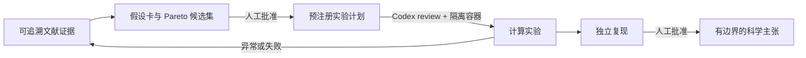

# AI Research Lab：使用与技术指南

本仓库是一个面向“表示失效”和“抽象掩盖异常”问题的可审计自动科研原型。它不把流畅的模型输出当作科学结论；每个研究动作必须回到可定位的文献、可证伪的假设、固定的实验方案和独立复现。

## 从问题到结论



控制器而非语言模型决定下一阶段。工件采用 SHA-256 内容哈希；证据、假设或实验计划发生变化时，相关批准和下游产物自动失效。

## 当前第一研究问题

**问题：** 当同样显著的残差来自测量、参数、结构或潜变量层面的不同原因时，AI 是否能选择正确的修复层级？将证据压缩为总体拟合摘要，是否会系统性增加欠修订？

正式输入文件：

- [`representation-repair-evidence.json`](../evidence/representation-repair-evidence.json)：八篇核心文献的角色、支持范围与边界。
- [`representation-repair-hypotheses.json`](../evidence/representation-repair-hypotheses.json)：H1–H4 的机制、预测、falsifier 与推进状态。
- [`representation-repair-pilot-v1.json`](../reports/representation-repair-pilot-v1.json)：首轮半合成计算结果。

H1 是当前运行的测量工具验证，不是关于真实科学数据或真实科学 agent 的结论。H2–H4 是已预注册但尚未执行的扩展。

## 本地快速开始

```powershell
python -m pip install -e .
python -m ai_research_lab.demo --literature-db "C:\path\to\ai-auto-science-literature\literature.db"
python -m ai_research_lab.repair_benchmark --output reports\representation-repair-pilot-v2.json
python -m unittest discover -s tests -v
```

基准的输出命令拒绝覆盖已有结果文件。它使用三个预注册随机种子，生成 100 个已知原因案例/seed，并比较“仅总体摘要”的压缩策略与“保留残差签名”的诊断策略。

## 技术设计

### 研究工件

`ResearchArtifact` 将 JSON 负载标准化并计算 SHA-256。`ArtifactApproval` 只认可一个精确的工件哈希。`ExperimentPlan` 绑定证据和假设哈希，并固定基线、主指标、种子、预期模式和反证条件。`ScientificClaim` 还必须绑定实验与独立复现工件，并记录局限。

### 候选选择

`pareto_hypotheses(...)` 对已记录的四类评分作非支配选择：证据强度、与直接前序工作的差异、可证伪性和预计执行成本。它不生成评分，也不将模型偏好视为事实。

### 代码执行

`.codex/gated-multiagent/workflow.contract.json` 定义确定性 DAG。两个可能执行代码的阶段都要求 `artifact-hash`、`codex-review` 与 `container-execution` gate，并指向 `execution.py`。Windows 只允许准备与验证；实际生成代码必须在共享的 Ubuntu/Docker 环境中经 `Interpreter.run()` 执行，默认禁网且不向容器传递主机凭据。

## 与成熟项目的差距

| 维度 | 当前仓库 | 成熟项目通常具备 | 近期优先级 |
| --- | --- | --- | --- |
| 研究可信度 | 证据哈希、审批、复现与结论门槛已实现 | 多领域真实任务、长期回归集和独立第三方复现 | 高：扩展半合成基准到真实公开数据 |
| 运行体验 | 本地 Python demo、可验证合同 | 一键安装、多环境配置、Web UI、任务可视化与恢复 | 中：先完成可重复 CLI 示例，再考虑 UI |
| 文档与品牌 | README、中文技术指南、图标、架构图 | 完整 API 文档、教程、案例库、版本化发布说明 | 中：为每个完成的基准添加案例页 |
| 工具生态 | Robin/ToolUniverse 本地发现边界 | 丰富工具目录、异步任务、生产化 MCP 连接器 | 低：只按实际研究域接入经审查的工具 |
| 模型与执行 | 共享隔离执行内核、无静默 fallback | 多环境 GPU 部署、观测平台、成本追踪 | 中：先增加真实运行的资源与失败日志 |

不应仅为“看起来成熟”而复制大型平台。先积累 2–3 个真实、可复跑的研究案例、比较基线和失败分析，才是最能提升可信度的包装。

## 发布边界

仓库公开的是代码、合同、合成样例和可复现的结果记录；不公开 API key、私有文献 PDF、付费平台访问、主机凭据或未审查研究结论。任何使用 AI Scientist-v2、Robin 或外部科学工具的后续运行，必须在对应运行记录中写明版本、许可证、输入来源和人工审核人。
